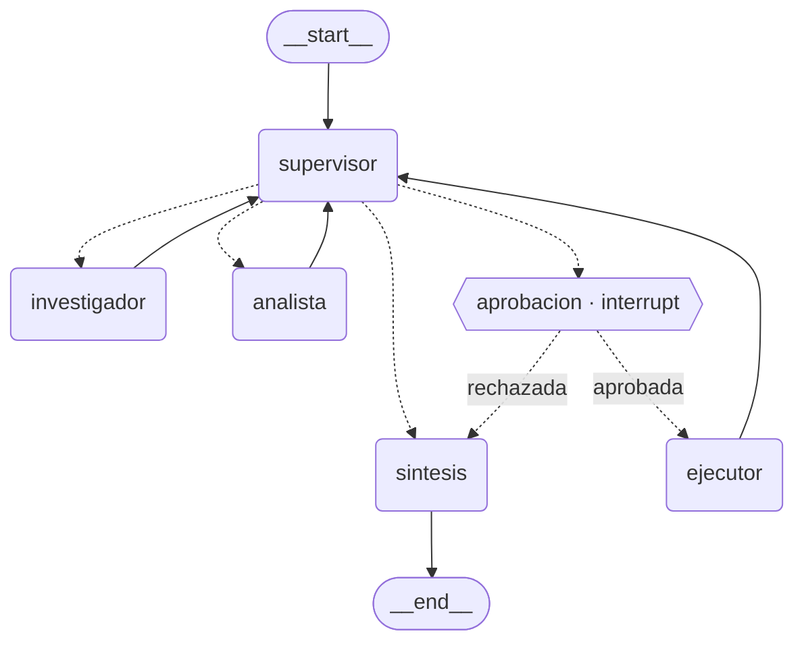

# Pre-entrega 7 — API de producción y monitoreo activo

API REST (FastAPI) que expone el orquestador multi-agente del módulo 6 (Supervisor + Investigador +
Analista sobre la base del **Hotel Bahía Serena**) con cuatro capacidades nuevas:

| Capacidad | Dónde |
|---|---|
| Endpoints asíncronos: `POST /tasks` encola y devuelve un `job_id` al instante | [app/main.py](app/main.py), [app/worker.py](app/worker.py) |
| Estado de los jobs y checkpoints de LangGraph en **Redis** (`PENDING/RUNNING/AWAITING_APPROVAL/DONE/FAILED`) | [app/jobs.py](app/jobs.py), `checkpointer_redis` en [app/graph.py](app/graph.py) |
| Observabilidad: trazas de cada nodo y llamada al LLM en **Arize Phoenix** (o LangSmith) | [app/observability.py](app/observability.py) |
| **Human-in-the-loop**: pausa obligatoria antes de acciones con efectos secundarios | [app/hitl.py](app/hitl.py), [app/agents/executor_agent.py](app/agents/executor_agent.py) |

La pre-entrega 6 original quedó intacta en `entregas/clase_6/` (carpeta local, fuera de git).

## Arquitectura

```
cliente ── POST /tasks ──► FastAPI ──► Redis: job:<id> = PENDING ──► asyncio.Queue
   ▲                          │                                          │
   │  GET /tasks/{id}         │                              N consumidores (worker)
   └──────── Redis ◄──────────┴──── RUNNING/DONE/FAILED ◄── grafo.ainvoke(thread_id=job_id)
                                                                │  checkpoints ──► Redis (AsyncRedisSaver)
                                                                └  spans ──► Phoenix / LangSmith
```

* **No bloquea el event loop**: el endpoint solo escribe en Redis (`redis.asyncio`) y pone el job en
  una cola; el worker usa `grafo.ainvoke` (async nativo). No hay llamadas sync a LLM ni a Redis.
* **Errores en segundo plano**: `Worker._ejecutar` captura *cualquier* excepción (LLM caído,
  `recursion_limit`, timeout de `JOB_TIMEOUT_S`, apagado de la API) y deja el job en `FAILED` con el
  error. El cliente que hace polling siempre llega a un estado final o de espera.
* **Worker**: la versión de un solo proceso (consumidores `asyncio`). El contrato (estado y
  checkpoints en Redis, `thread_id = job_id`) permite pasarlo a Arq/Celery sin tocar el grafo.

### Flujo Human-in-the-loop



(El diagrama generado desde el grafo real está en [docs/grafo.mmd](docs/grafo.mmd).)

**Tarea crítica** = la que implica la herramienta `cancelar_reserva` (efecto real e irreversible:
cancela y cobra una penalidad). El supervisor solo puede llegar al `ejecutor` a través del nodo
`aprobacion` (el router `enrutar` lo fuerza: `ejecutor → aprobacion`), que llama a `interrupt()`:

1. El grafo se congela y su estado queda en Redis; el job pasa a `AWAITING_APPROVAL` y
   `GET /tasks/{id}` devuelve en `pendiente` qué acción espera aprobación.
2. `POST /tasks/{id}/approve` con `{"aprobado": true|false, "comentario": "..."}` reanuda el mismo
   `thread_id` con `Command(resume=...)`. Aprobada → corre el ejecutor; rechazada → se cierra sin
   ejecutar nada. La transición `AWAITING_APPROVAL → PENDING` es atómica (`WATCH/MULTI`): dos
   aprobaciones simultáneas no ejecutan dos veces (la segunda recibe `409`), y una guarda
   determinística impide que el ejecutor corra más de una vez por tarea.

## Cómo levantarlo

Requisitos: Python 3.12+, Docker (para Redis Stack y Phoenix) y una API key de LLM.

```bash
python -m venv .venv && source .venv/bin/activate      # Windows: .venv\Scripts\activate
pip install -r requirements.txt
cp .env.example .env                                   # completar GEMINI_API_KEY (u OPENAI_API_KEY)

docker compose up -d redis phoenix                     # Redis Stack :6379 · Phoenix :6006
uvicorn app.main:app --port 8000
```

> El checkpointer necesita **Redis Stack** (RediSearch + RedisJSON); un Redis "pelado" no sirve.
> `docker compose up -d --build` levanta además la API en un contenedor.

Uso manual:

```bash
curl -X POST localhost:8000/tasks -H 'content-type: application/json' \
  -d '{"pregunta": "¿Cuánto pago de penalidad si cancelo 4 noches a USD 150 en temporada alta, 3 días antes?"}'
# → {"job_id": "…", "status": "PENDING"}
curl localhost:8000/tasks/<job_id>                     # polling: RUNNING → DONE (respuesta, pasos, contribuciones)

# Tarea crítica: queda en AWAITING_APPROVAL hasta que un humano responde
curl -X POST localhost:8000/tasks -H 'content-type: application/json' \
  -d '{"pregunta": "Cancelá la reserva BS-10482 (4 noches a USD 150, temporada alta, 3 días antes) y cobrá la penalidad."}'
curl -X POST localhost:8000/tasks/<job_id>/approve -H 'content-type: application/json' \
  -d '{"aprobado": true, "comentario": "ok recepción"}'
```

Documentación interactiva en `http://localhost:8000/docs`.

## Prueba de carga: 5 peticiones concurrentes

```bash
python scripts/carga.py            # 5 peticiones simultáneas, polling hasta DONE/FAILED
python scripts/carga.py --aprobar  # idem, aprobando solas las que pidan aprobación humana
```

Imprime, por petición, cuánto tardó el `POST` en responder (milisegundos: no espera al agente) y el
tiempo total, más la mediana y el p95 **vistos por el cliente**. El `WORKER_CONCURRENCIA` (5 por
defecto) define cuántas corren a la vez; si el proveedor tiene cuota baja (free tier de Gemini) bajalo
y usá `LLM_RPM`.

### Evidencia (carpeta [screenshots/](screenshots/))

Con la corrida terminada, abrí Phoenix en `http://localhost:6006` → proyecto `orquestador-hotel` y
capturá:

1. **Trazas**: lista de traces y el detalle de una (un span por nodo: supervisor → investigador →
   analista → … → síntesis, con las llamadas al LLM y las tools).
2. **Costo por ejecución**: columna *Cost* de la lista de traces (Phoenix la calcula a partir de los
   tokens de entrada y salida y la tabla de precios del modelo).
3. **Latencia p95**: panel de resumen del proyecto (*Latency P95*).
4. Para la lectura del dashboard: ordená los spans por *Latency* y por *Total tokens* para ver qué
   nodo concentra la latencia y los tokens (típicamente el investigador, por el contexto recuperado,
   y el supervisor, que se invoca en cada vuelta).

Cada traza lleva `job_id` y `session_id = job_id` en la metadata: filtrando por ese valor ves todo lo
que hizo una tarea, incluso si se pausó por aprobación.

**LangSmith en vez de Phoenix**: en `.env` poné `OBSERVABILITY=langsmith`, `LANGSMITH_API_KEY=…`; no hace
falta tocar código.

## Variables de entorno

Ver [.env.example](.env.example): `REDIS_URL`, `WORKER_CONCURRENCIA`, `JOB_TIMEOUT_S`,
`OBSERVABILITY` (`phoenix|langsmith|none`), `PHOENIX_COLLECTOR_ENDPOINT`, claves del LLM, etc.

## Tests

```bash
pip install -r requirements-dev.txt
pytest          # offline: LLM guionado + fakeredis + checkpointer en memoria
ruff check . && mypy app tests scripts
```

Cubren: encolado sin esperar al agente, pausa y reanudación HITL (aprobada y rechazada), doble
aprobación (`409`), paso a `FAILED` ante una excepción del agente, y las guardas del supervisor.
Los tests no necesitan Redis, Phoenix ni API keys.

## Estructura

```
app/
  main.py            FastAPI: POST /tasks · GET /tasks/{id} · GET /health
  worker.py          cola + consumidores; actualiza el estado en Redis (y FAILED ante excepciones)
  jobs.py            JobStore sobre Redis (hash por job, TTL 24 h, transición atómica)
  graph.py           orquestador del M6 + nodo de aprobación + checkpointer Redis
  hitl.py            nodo `aprobacion` (interrupt) y POST /tasks/{id}/approve
  observability.py   init de Phoenix/OpenInference o LangSmith + metadata por job
  agents/            supervisor, investigador, analista (M6) y ejecutor (acciones críticas)
  state.py llm.py config.py base_hotel.py data/
scripts/carga.py     prueba de carga de 5 peticiones concurrentes
screenshots/         capturas del dashboard
docker-compose.yml   Redis Stack + Phoenix (+ la API, opcional) · Dockerfile
```
