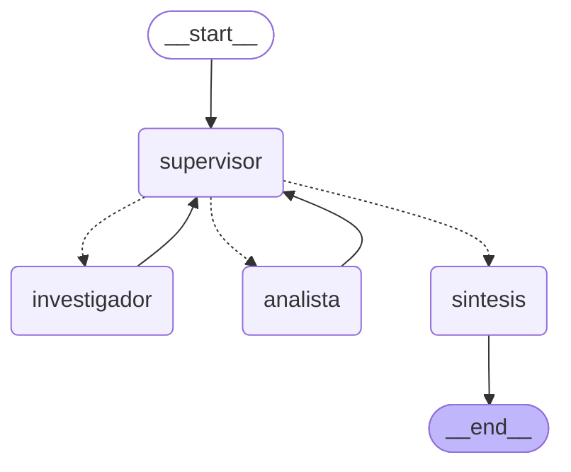

# Pre-entrega 6 — Orquestador multi-agente especializado

Un **Supervisor** (router + controlador de flujo) coordina a dos especialistas sobre la base de
conocimiento del **Hotel Bahía Serena** (la de las pre-entregas 3 y 4):

| Agente | Rol | Herramientas (acotadas a su rol) |
|---|---|---|
| **Supervisor** | Decide quién interviene, valida con una rúbrica y cierra. | — (salida estructurada `Decision`) |
| **Investigador** | Encuentra datos en los documentos del hotel. No calcula. | `buscar_en_documentos_hotel` (BM25 + Pinecone), `listar_documentos_hotel` |
| **Analista** | Procesa los datos ya recopilados. No accede a los documentos. | `calcular`, `extraer_cifras`, `analizar_sentimiento` |
| **Síntesis** | Redacta la respuesta final a partir de los hallazgos. | — |

Ejemplo (el de la demo): *"Reservó 4 noches a USD 150 con tarifa de temporada alta y cancela 3 días
antes. ¿Cuánto paga de penalidad y qué plazo tenía para cancelar sin cargo?"* → el investigador
encuentra la regla (50 % de la estadía; plazo de 7 días), el analista calcula USD 300 y el supervisor
cierra.

## Topología



Generado desde el grafo real con `python main.py diagrama` (escribe `docs/grafo.mmd` y
`docs/grafo.png`, este último vía `draw_mermaid_png()`). Las líneas punteadas son las aristas
condicionales: las decide el supervisor en tiempo de ejecución.


### ¿Por qué esta topología?

**Jerárquica en estrella (hub-and-spoke)**: los especialistas nunca se hablan entre sí; todo pasa
por el supervisor. Frente a las alternativas:

- *Cadena fija* (investigador → analista → fin): no puede refinar ni saltear pasos. Una consulta
  que solo pide un dato no necesita analista.
- *Red de agentes que se llaman entre sí*: el flujo es difícil de seguir y de acotar; dos agentes
  pueden entrar en un bucle de correcciones sin que nadie lo vea.
- *Estrella*: hay **un solo punto de decisión y de control** (dónde se valida, dónde se corta). Es
  más barato en tokens, auditable (cada turno queda registrado) y escala agregando un nodo
  especialista y una opción en el `Literal` del supervisor.

### Cómo se manejan los conflictos y los bucles

| Riesgo | Mecanismo |
|---|---|
| **Supervisor infinito** | Tres frenos en capas: `MAX_PASOS` (turnos de especialistas), `MAX_REFINAMIENTOS` (cuántas veces se puede reabrir al *mismo* especialista) y `recursion_limit` de LangGraph como red de seguridad. Al alcanzar un tope, el supervisor fuerza `FINISH`. Las guardas viven en código (`aplicar_guardas`), no en el prompt: el LLM no puede saltárselas. |
| **El analista y el investigador "no coinciden"** | La rúbrica del supervisor exige **consistencia** (las cifras del analista deben coincidir con las del investigador). Si no, el supervisor devuelve el trabajo al responsable con una consigna de refinamiento concreta. No discuten entre ellos: arbitra el supervisor. |
| **Analista sin datos / cierre sin investigar** | Guardas deterministas: redirige a `investigador`. |
| **Pérdida de contexto** | `hallazgos` y `contribuciones` tienen reducers explícitos (`fusionar_hallazgos`, `operator.add`): lo que escribe un agente no pisa lo de otro. |
| **Contaminación de contexto** | Cada especialista corre como agente ReAct **aislado** y recibe solo *consigna + pedido original + los hallazgos que necesita*; no ve el historial, ni las llamadas a herramientas de otros. El supervisor ve los hallazgos y sus fuentes, no las trazas de herramientas. |
| **Alucinación** | El investigador solo responde con lo que devuelve la búsqueda y cita archivo y sección; la rúbrica exige fuentes. El analista no tiene acceso a los documentos: si falta un dato, lo dice. |
| **Servicio externo caído** | Si no hay `PINECONE_API_KEY` (o Pinecone/embeddings fallan), la búsqueda degrada a BM25 local con un aviso. |

## Estructura

| Archivo | Rol |
|---|---|
| `state.py` | `EstadoOrquestador(MessagesState)`: `next_agent`, `instruccion`, `hallazgos`, `contribuciones`, `pasos`, `task_completed`, `respuesta_final`. |
| `agents/research_agent.py` | Investigador: prompt, tools y entrada acotada. |
| `agents/analyst_agent.py` | Analista: `calcular` (evaluador aritmético seguro con `ast`, sin `eval`), `extraer_cifras`, `analizar_sentimiento`. |
| `agents/supervisor.py` | `Decision` (salida estructurada), prompt con **rúbrica**, `aplicar_guardas`, nodo de síntesis. |
| `agents/common.py` | Envoltorio común: ejecuta un `create_react_agent` aislado y vuelca el resultado al estado. |
| `graph.py` | `StateGraph`, nodos, arista condicional (`enrutar` con retorno `Literal`) y estado inicial. |
| `base_hotel.py` | Corpus `data/*.md`, chunking y recuperador híbrido (BM25 + Pinecone) de las pre-entregas 3 y 4. |
| `trazas.py`, `main.py` | Runner que reconstruye la traza de delegación; CLI. |
| `demo.ipynb`, `trazas/` | Demo del flujo de delegación (salidas de una corrida real). |
| `tests/` | 28 tests offline (LLM guionado): herramientas, flujo completo, refinamiento, aislamiento de contexto, supervisor infinito, guardas. |

## Cómo correrlo

Requiere **Python 3.12+**.

```bash
python -m venv .venv
.venv\Scripts\activate            # Linux/macOS: source .venv/bin/activate
pip install -r requirements.txt
cp .env.example .env              # y completar GEMINI_API_KEY (u OPENAI_API_KEY)
```

> Las API keys viven **solo** en `.env`, que está en `.gitignore`. Nunca se suben.
> Para usar la búsqueda híbrida, agregá `PINECONE_API_KEY` (e `INDEX_NAME`) al `.env`: el índice es
> el de la pre-entrega 4. Sin eso, el investigador usa solo BM25 local sobre `data/`.

```bash
python main.py demo                       # la consulta de la consigna; guarda trazas/traza_demo.{json,log}
python main.py preguntar "¿Cuánto cuesta el late check-out pasadas las 13:00?"
python main.py diagrama                   # regenera docs/grafo.mmd y docs/grafo.png
```

Tests (no necesitan red ni keys):

```bash
pip install -r requirements-dev.txt
pytest && ruff check . && mypy *.py agents tests
```

> **Free tier de Gemini:** una consulta completa son ~10 requests (supervisor ×3, síntesis y los
> ciclos ReAct de cada especialista). Con `LLM_RPM=4` un rate limiter compartido espacia las
> llamadas; si un modelo agota su cuota diaria, probá otro con `LLM_MODEL=gemini-3.5-flash-lite`.

## Criterios de la consigna → dónde se cumplen

| Requisito | Dónde |
|---|---|
| Topología jerárquica con nodo Supervisor | `graph.py`, `agents/supervisor.py` |
| ≥ 2 especialistas con tools funcionales | `agents/research_agent.py` (DB del hotel), `agents/analyst_agent.py` |
| Estado compartido que rastrea quién aportó qué | `state.py`: `hallazgos` + `contribuciones` |
| Supervisor decide si está completo o hay que refinar | `Decision` + rúbrica en `PROMPT_SUPERVISOR`; test `test_refinamiento_*` |
| Aristas condicionales con `Literal` | `graph.enrutar` y `state.Siguiente` |
| Validación antes del `END` | Rúbrica de 4 puntos (fuentes, completitud, cómputo, consistencia) |
| Evitar el supervisor infinito / contaminación de contexto | Ver tabla de arriba; tests `test_supervisor_infinito_*` y `test_el_analista_recibe_la_consigna_y_los_datos_no_el_historial` |
